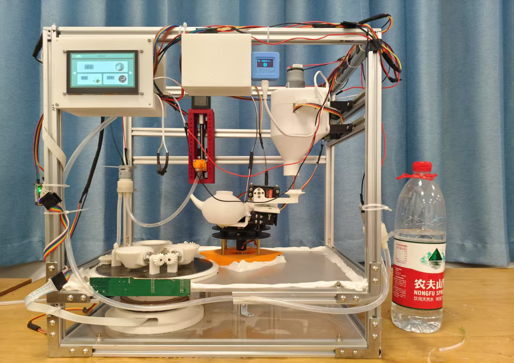

# Intelligent Tea Art Machine

[简体中文](README.md) | **English**

**Build a machine that loads tea, adds water, moves the pot, and pours a cup.**

An STM32G431-based DIY tea machine combining mechanical parts, electronics, a serial touchscreen, and a WeChat Mini Program. Explore automated tea-making, or start with a single servo, a water circuit, or a control interface to build your own tea station.



## What is included

| Module | Contents |
| --- | --- |
| Tea-making sequences | Tea loading, water filling, pot shaking, pouring, and cleaning routines |
| Motion control | Smooth servo movement, stepper position and speed control, DC motor and pump drivers |
| User interfaces | Local serial touchscreen control and networking code for Wi-Fi, OneNET, and a WeChat Mini Program |
| Build resources | Circuit projects, schematics, SolidWorks/STEP models, and prototype photos |
| AI experiments | A separate NanoEdge AI odor-signal classification project requiring its own setup |

## Repository guide

| Directory | Purpose |
| --- | --- |
| [01_Hardware](01_Hardware/) | Circuit projects, schematic PDFs, and temperature-circuit simulation |
| [02_Software/01_Source_Code/tea](02_Software/01_Source_Code/tea/) | Current STM32 controller project |
| [02_Software/02_UI](02_Software/02_UI/) | Serial touchscreen HMI projects, TFT files, and UI assets |
| [02_Software/03_wxxcx](02_Software/03_wxxcx/) | WeChat Mini Program |
| [02_Software/01_Source_Code/EdgeAI](02_Software/01_Source_Code/EdgeAI/) | Standalone AI classification experiment; related libraries are in the sibling `ai/` folder |
| [02_Software/00_Ref/test2](02_Software/00_Ref/test2/) | Reference project and stepper-control notes |
| [03_Mechanical](03_Mechanical/) | Parts, assemblies, and STEP models |
| [04_Tools](04_Tools/) | Supporting tools and local configuration examples |
| [05_Information](05_Information/) | Prototype photos and project materials |

## Getting started

```bash
git clone https://github.com/Epiphany-Leave/IntelligentTeaArt_Machine.git
cd IntelligentTeaArt_Machine
```

1. **Explore the build** using the [photos](05_Information/电子版照片), [mechanical models](03_Mechanical/), and [schematics](01_Hardware/01_Project/).
2. **Open the firmware**: use Keil for [tea2.uvprojx](02_Software/01_Source_Code/tea/MDK-ARM/tea2.uvprojx) and STM32CubeMX for [tea2.ioc](02_Software/01_Source_Code/tea/tea2.ioc). Both retain the `tea2` filename and belong to the current `tea` project.
3. **Adjust the movements**: inspect sequence tables in [app.c](02_Software/01_Source_Code/tea/MDK-ARM/APP/app.c) and position settings in [commond.h](02_Software/01_Source_Code/tea/MDK-ARM/APP/commond.h). [TaskList.c](02_Software/01_Source_Code/tea/MDK-ARM/TimePiece/TaskList.c) handles periodic tasks.
4. **Add the interfaces**: choose an HMI project matching your screen model and resolution. Configure your own Wi-Fi, OneNET device, and Mini Program when adding phone control.

Controller sources are consolidated in `tea/`. Open `tea/MDK-ARM/` when using the included VS Code configuration.

## Network setup

Network credentials are blank by default. Without configuration, the firmware skips networking and the Mini Program skips the corresponding cloud requests. Supply your own Wi-Fi, OneNET device, and authentication settings before testing; weather features also require your own weather API key.

See [network configuration](docs/NETWORK_CONFIGURATION.md#english) for file locations, MQTT versus HTTP tokens, and tool usage. A client-side Mini Program cannot securely conceal long-lived keys; use your own backend to proxy requests for production deployments.

## DIY and contributions

This is a learning and experimental project. Calibrate angles, travel, and timing for your hardware. For initial motion tests, disconnect the heating load, use cold water, and check power supplies and leak protection.

Share questions, improvements, and build photos through [Issues](https://github.com/Epiphany-Leave/IntelligentTeaArt_Machine/issues) or pull requests. Parts lists, wiring notes, and assembly tips help others get started.

## License

Original project content is released under the [MIT License](LICENSE). Third-party code and libraries, including STM32 HAL, CMSIS, LVGL, and NanoEdge AI, retain their own copyright and license terms.
