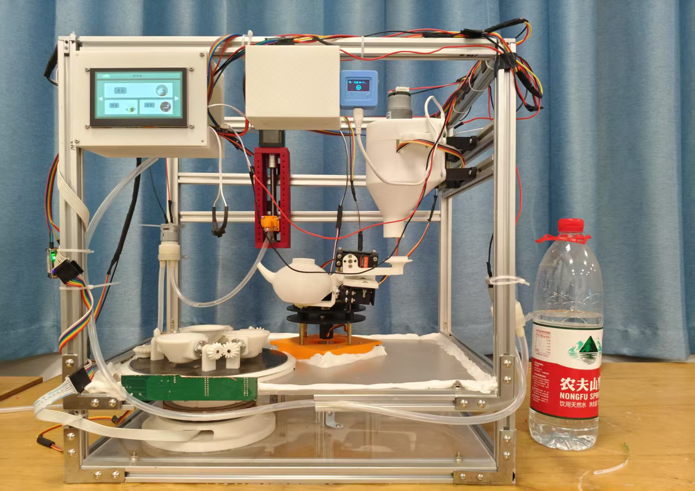

# 智能茶艺机 · Intelligent Tea Art Machine

**简体中文** | [English](README.en.md)

**让自己做的机器，完成添茶、注水、摇壶和倒茶。**

一个基于 STM32G431 的茶艺机 DIY 项目，结合机械机构、电路、串口触摸屏与微信小程序。你可以研究自动泡茶流程，也可以从一个舵机、一套水路或一个控制界面开始，制作自己的机械茶台。



## 项目能做什么

| 模块 | 内容 |
| --- | --- |
| 茶艺动作 | 添茶、注水、摇壶、倒茶和清洗的动作编排 |
| 机构控制 | 舵机缓动、步进电机位置与速度控制、直流电机及水泵驱动 |
| 操作界面 | 串口屏本地操作，以及 Wi-Fi、OneNET 和微信小程序的联网交互代码 |
| 制作资料 | 电路工程、原理图、SolidWorks／STEP 模型和实物照片 |
| AI 实验 | 独立的 NanoEdge AI 气味信号分类工程，需要单独调试 |

## 目录导航

| 目录 | 用途 |
| --- | --- |
| [01_Hardware](01_Hardware/) | 电路工程、原理图 PDF 与温度电路仿真 |
| [02_Software/01_Source_Code/tea](02_Software/01_Source_Code/tea/) | 当前 STM32 主控工程 |
| [02_Software/02_UI](02_Software/02_UI/) | 串口屏 HMI 工程、TFT 文件与界面素材 |
| [02_Software/03_wxxcx](02_Software/03_wxxcx/) | 微信小程序 |
| [02_Software/01_Source_Code/EdgeAI](02_Software/01_Source_Code/EdgeAI/) | 独立 AI 分类实验；相关库位于同级 `ai/` |
| [02_Software/00_Ref/test2](02_Software/00_Ref/test2/) | 参考工程与步进电机控制说明 |
| [03_Mechanical](03_Mechanical/) | 零件、装配体和 STEP 模型 |
| [04_Tools](04_Tools/) | 辅助工具与本地配置示例 |
| [05_Information](05_Information/) | 实物照片等项目资料 |

## 从哪里开始

```bash
git clone https://github.com/Epiphany-Leave/IntelligentTeaArt_Machine.git
cd IntelligentTeaArt_Machine
```

1. **看结构与电路**：结合[实物照片](05_Information/电子版照片)、[机械模型](03_Mechanical/)和[电路图](01_Hardware/01_Project/)理解整机组成。
2. **打开固件**：使用 Keil 打开 [tea2.uvprojx](02_Software/01_Source_Code/tea/MDK-ARM/tea2.uvprojx)；使用 STM32CubeMX 查看 [tea2.ioc](02_Software/01_Source_Code/tea/tea2.ioc)。文件名仍为 `tea2`，均属于当前 `tea` 工程。
3. **调整动作**：在 [app.c](02_Software/01_Source_Code/tea/MDK-ARM/APP/app.c) 查看动作表，在 [commond.h](02_Software/01_Source_Code/tea/MDK-ARM/APP/commond.h) 调整机构位置；[TaskList.c](02_Software/01_Source_Code/tea/MDK-ARM/TimePiece/TaskList.c) 负责周期任务。
4. **接入界面**：选择与屏幕型号、分辨率匹配的 HMI 工程；需要手机控制时，再配置自己的 Wi-Fi、OneNET 和小程序。

主控源码目录统一为 `tea/`。使用随附 VS Code 配置时，请打开 `tea/MDK-ARM/` 文件夹。

## 联网配置

联网参数默认留空：未配置时，固件跳过联网，小程序跳过相应云端请求。填写自己的 Wi-Fi、OneNET 设备与鉴权信息后再联调；天气功能还需自己的天气 API key。

配置位置、MQTT／HTTP token 的区别和工具用法见[联网配置说明](docs/NETWORK_CONFIGURATION.md)。小程序客户端无法安全隐藏长期密钥，生产部署应通过自己的服务端代理请求。

## DIY 与贡献

本项目用于学习与实验，需按实际硬件校准角度、行程和动作时序。首次机构调试先断开加热负载、使用冷水，并核对供电和防漏水保护。

欢迎通过 [Issues](https://github.com/Epiphany-Leave/IntelligentTeaArt_Machine/issues) 或 Pull Request 分享问题、改进和复现照片。补充器件清单、接线与装配经验，也能帮助下一位 DIY 爱好者。

## 许可证

原创内容采用 [MIT License](LICENSE)。STM32 HAL、CMSIS、LVGL、NanoEdge AI 等第三方代码或库仍遵循各自的版权与授权。
